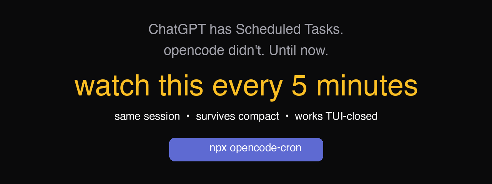

<p align="center">
  
</p>

# ⏰ opencode-cron — ChatGPT Scheduled Tasks for OpenCode + Mission Control Web GUI

> **ChatGPT introduced Scheduled Tasks. OpenCode was missing them. opencode-cron brings them to life — supercharged with persistent markdown memory, session binding, and a real-time Mission Control Web GUI.**

> 🌐 **Visit the launch site:** [culturedigitali.github.io/opencode-cron](https://culturedigitali.github.io/opencode-cron/) — available in 10 languages.

Tell OpenCode **“watch competitor releases every 15 minutes”** or **“re-check CI flaky tests every hour”** — and it continues autonomously in the exact same chat session. Even after context compact. Even when your terminal or TUI is closed.

[](https://www.npmjs.com/package/@culturedigitali/opencode-cron)
[](https://www.npmjs.com/package/@culturedigitali/opencode-cron)
[](LICENSE)
[](https://github.com/CultureDigitali/opencode-cron/actions/workflows/ci.yml)
[](https://bun.sh)
[](https://nodejs.org)
[](http://localhost:4488)
[](https://github.com/CultureDigitali/opencode-cron/stargazers)

---

### ⭐ If this saves you open tabs, background scripts, and burned tokens, consider starring the repo! It helps AI engineers discover true agent scheduling.

---

## 🚀 Why opencode-cron?

Traditional cron is **blind** — it runs an isolated shell script, forgets previous executions, loses conversational context, and can burn hundreds of dollars in looping API tokens.

**opencode-cron is an intelligent AI Agent Scheduler:**

* 🔄 **Same Conversation, Every Tick:** It re-prompts the **same `sessionID`** with full conversation history — not a detached CLI call.
* 🧠 **Persistent Markdown Memory:** Survives context compaction, restarts, and reboots. Tracks `seenHashes` to prevent repetitive notifications.
* 🖥️ **Mission Control Web GUI:** Sleek dark-mode dashboard at `http://localhost:4488` with live SQLite chat streaming, active job monitors, and instant controls.
* 🪟 **Cross-Platform Desktop App & System Tray:** Native installable packages for **macOS (.dmg)**, **Windows (.exe)**, and **Linux (.AppImage, .deb)** with a live system tray icon showing real-time OpenCode connection and active cron status.
* ⚡ **1-Click "Imposta Cron" Binding:** Bind an automated recurring schedule directly to any conversation session with visual schedule previews.
* 📊 **Execution Timeline & Diagnostics (`/runs`):** Real-time visibility into every tick: duration, status, exit codes, trigger source, and error logs.
* ⚡ **Smart Adaptive Schedule & Burst Mode:** Dynamically accelerates into high-frequency cadence (e.g. 1m) upon activity/discoveries and backs off to idle (e.g. 30m) when quiet — conserving LLM tokens while reacting instantly. Includes 1-click 15m Burst trigger in the GUI and `cron_burst` Code Mode tool.
* 🛡️ **Autonomous Background Daemon:** Keeps running overnight with your TUI or terminal closed via native `launchd`, `systemd`, or `schtasks`.

---

## ⚡ Plain Cron vs. opencode-cron

| Feature | Plain Cron / Bash Loops | opencode-cron |
|---|---|---|
| **Session Awareness** | ❌ Spawns blind one-off shells | ✅ **Re-prompts same session ID** with full context |
| **Context Compact Safe** | ❌ Wiped out on conversation compact | ✅ **Compaction hook re-injects memory file** |
| **Deduplication** | ❌ Repeats same alerts every tick | ✅ **`seenHashes` dedup prevents repeat alerts** |
| **Loop / Token Protection** | ❌ Can loop infinitely, burning tokens | ✅ **60s min, 5-fail circuit breaker, `maxRuns`** |
| **User Interface** | ❌ Terminal only / crontab file | ✅ **Web GUI Mission Control (`localhost:4488`)** |
| **Observability** | ❌ Grepping obscure syslog files | ✅ **Dedicated `/runs` Timeline with error traces** |
| **Multi-Language** | ❌ English only / none | ✅ **10 languages with interactive onboarding tour** |

---

## ⏱️ 30-Second Quickstart

### 1. Add Plugin to OpenCode
Add `@culturedigitali/opencode-cron` to your `opencode.json`:
```jsonc
{
  "$schema": "https://opencode.ai/config.json",
  "plugins": ["@culturedigitali/opencode-cron"]
}
```

### 2. Launch Mission Control Web GUI
Start the dashboard in one command:
```bash
npx @culturedigitali/opencode-cron gui
# Or if working in this repo:
bun run gui
```
Open **`http://localhost:4488`** in your browser. You get full access to:
- **Mission Control (`/`)**: View jobs, inspect SQLite sessions, trigger test ticks, edit memory.
- **Execution History (`/runs`)**: Live timeline of successes, failures, and execution latencies.
- **Interactive Guide (`/instructions`)**: 8-chapter visual documentation + interactive onboarding tour.

### 3. Schedule Your First Job
You can create jobs in two simple ways:

* **Via the Web GUI:** Open any session in Mission Control and click **`⚡ Imposta Cron`**. Choose your schedule (`5m`, `30m`, `cron: 0 9 * * *`), set optional duration (`maxRuns`), type your prompt, and save.
* **Via OpenCode Chat:**
  ```
  /cron-add → "Controlla le novità AI ogni 15m e salva i risultati"
  ```

### 4. Enable Background Execution (TUI Closed)
Keep tasks running autonomously overnight:
```bash
npx @culturedigitali/opencode-cron os-install
```
* **macOS:** Installs `ai.opencode.cron` launchd daemon (`~/Library/LaunchAgents/`).
* **Linux:** Generates systemd service + timer (`systemctl --user`).
* **Windows:** Configures Task Scheduler via `schtasks`.

---

## 📸 Explore the Features

### 🖥️ Mission Control Web Dashboard (`localhost:4488`)
Manage your entire AI automation fleet in one place:
- **Active Cron Matrix:** Live counters, last tick results, next execution countdowns, and quick pause/resume toggles.
- **SQLite Session Streamer:** Read active and archived chats in real time with auto-refresh and diff highlight.
- **Markdown Memory Studio:** Directly view and edit `.opencode/cron/memory/<id>.md` to steer agent memory without touching terminal files.

### ⚡ 1-Click "Imposta Cron" Session Modal
Never write complex cron strings by hand again:
- **Preset Buttons:** Quick intervals (`5m`, `15m`, `30m`, `1h`, `daily`).
- **Visual Schedule Explainer:** Translates expressions into natural human language and previews the next 3 scheduled run timestamps in real time.
- **Finite vs Infinite Runs:** Set `0` for perpetual automation, or specify `N` (e.g., `5` runs) to automatically mark the job completed once finished.

### 📊 Execution Timeline & Diagnostics (`/runs`)
Full observability into your background workers:
- **Live Status Badges:** Success (`200 OK`), Failed (`ERR`), Skipped, or In-Flight.
- **Detailed Metrics:** Exact runtime duration (e.g., `1240ms`), exit codes, trigger origin (launchd daemon vs manual test).
- **Collapsible Error Traces:** Inspect stack traces, HTTP errors, and model timeouts with one click.
- **Summary Cards & Filters:** Real-time counters for Total Runs, Success Rate %, and Active Jobs.

### 🌍 Universal 10-Language i18n Suite
Localized experience with zero-latency client-side switching:
- 🇬🇧 English · 🇮🇹 Italiano · 🇪🇸 Español · 🇫🇷 Français · 🇩🇪 Deutsch
- 🇵🇹 Português · 🇨🇳 中文 · 🇯🇵 日本語 · 🇷🇺 Русский · 🇸🇦 العربية (Full RTL support)

### 🎓 Interactive Onboarding Tour
First time in Mission Control? An automatic 5-step guided tour highlights key features (Session selector, Imposta Cron modal, Execution Timeline, Memory editor, and Language switcher). Click **"Demo"** anytime in the navigation bar to replay it.

### 🪟 Native Desktop App & System Tray Monitor (macOS, Windows, Linux)
Run OpenCode Cron as an elegant, native desktop application that lives quietly in your system tray / menu bar:
* **Live System Tray / Menu Bar Icon:**
  - Dynamic status indicator (🟢 Connected / 🔴 Disconnected) with OpenCode daemon heartbeat.
  - **Live Cron Matrix Submenu:** Hover over the tray icon to see all active cronjobs, their frequencies, and exact countdowns to the next execution (e.g. `• AI News Watcher (5m) — Prossimo: tra 4m`).
  - **1-Click Quick Actions:** Run due jobs immediately (`⚡ Esegui Job Scaduti Ora`), reload rotated desktop sidecar credentials (`🔑 Ricarica Credenziali Desktop`), or open the external browser.
  - **Run on Startup:** Built-in auto-start toggle (`Avvia all'avvio del computer`) ensures your automations resume seamlessly across system reboots.
* **Frameless Dark Architecture:** Designed with sleek macOS `hiddenInset` traffic lights, ultra-clean `#030712` dark styling, and automatic **minimize-to-tray on window close** (never terminates your scheduled jobs by mistake).
* **Cross-Platform Installers:**
  - **macOS:** Universal `.dmg` installer & `.zip` (Apple Silicon & Intel).
  - **Windows:** NSIS Installer `.exe` & standalone Portable `.exe`.
  - **Linux:** Standalone `.AppImage` & Debian package `.deb`.
* **Launch or Package locally:**
  ```bash
  # Launch desktop tray app:
  bun run desktop
  # Or via CLI:
  npx @culturedigitali/opencode-cron desktop

  # Build standalone packages for your OS:
  bun run dist:mac    # Builds release/*.dmg
  bun run dist:win    # Builds release/*.exe
  bun run dist:linux  # Builds release/*.AppImage
  bun run dist:all    # Matrix package for all platforms
  ```

### 🔗 Multi-Job Pipeline & Directed Acyclic Graph (DAG) Workflows
Chain independent cron jobs into resilient, multi-step agent pipelines:
- **`onSuccess` & `onFailure` Triggers:** Automatically launch downstream jobs when a parent step completes or errors out (e.g. `Scrape Data` ➔ `Analyze News` ➔ `Generate Summary Report` ➔ on failure `Alert Discord/Slack`).
- **Interactive DAG Graph Visualizer:** Click **"Workflow DAG"** in the Web GUI navigation bar to inspect the topological tree with root nodes, directed edges, cycle safety checks, and real-time execution states.
- **Cross-Job Memory Propagation (`passPayload`):** Automatically injects the upstream step's markdown summary into the child job's persistent memory file, passing vital context without monotonic memory bloat (auto-pruned sliding window).
- **Formal DFS 3-Color Cycle Prevention:** Circular dependencies and self-loops are mathematically rejected at configuration time with descriptive error paths.

### 📡 Inbound Webhooks & Event-Driven HTTP Trigger Receiver
Trigger scheduled agent workflows on-demand from external services without waiting for interval ticks:
- **Zero-Config HTTP Endpoints (`/api/webhook/:id`):** Trigger any job via `POST /api/webhook/:jobId?token=whk_...` or header `X-Webhook-Token: whk_...`.
- **GitHub & GitLab Native Integration (`X-Hub-Signature-256`):** Supports shared HMAC-SHA256 signature verification to securely process inbound Git pushes, PRs, issues, or CI/CD deployments.
- **Context Injection (`passPayload`):** Incoming webhook JSON events (e.g. commits, author, issue details) are structured into concise markdown and injected into the agent's persistent memory before the run starts.
- **Anti-Spam Rate-Limiting & Debounce:** Built-in configurable cooldowns prevent webhook flood attacks and token-spend exhaustion.
- **Web GUI Token Management:** Regenerate secret tokens with 1 click, copy formatted cURL snippets, or trigger immediate test events directly from the Web GUI modal.

### ⚡ Execution Concurrency & Priority Worker Pool
Manage parallel task throughput, prevent system overload, and ensure critical workflows run first:
- **Priority-Weighted Queue (`high`, `normal`, `low`):** Mark urgent tasks as `high` (3x priority weight) so they execute before normal or low background jobs.
- **Bounded Parallel Worker Pool (1 to 10 Workers):** Run multiple due jobs simultaneously up to your configured `maxConcurrency` limit (default 2), eliminating queue head-of-line blocking.
- **Live Process Lock Validation (`.opencode/cron/locks/`):** Mutual exclusion across terminal sessions and OS daemons via POSIX-safe PID inspection (`process.kill(pid, 0)`), preventing duplicate runs while automatically pruning dead process locks.
- **Interactive Web GUI Queue Manager:** Real-time `#queue-modal` displaying active workers, in-flight jobs, queued tasks with priority badges, dynamic concurrency slider, and one-click task cancellation or queue flushing.

---

## 🛠️ Complete Tool Reference (14 Tools)

Agents equipped with `@culturedigitali/opencode-cron` have access to 14 native tools:

| Tool | Purpose | Key Parameters |
|---|---|---|
| `cron_add` | Create recurring scheduled task bound to current session | `title`, `every` (e.g. `5m`) or `cron` (e.g. `*/15 * * * *`), `systemPrompt`, `followupPrompt`, `maxRuns`, `catchUp`, `priority`, `pipeline`, `webhook` |
| `cron_list` | List all active and paused jobs for the project | *None* |
| `cron_get` | Inspect detailed job state and metadata | `id` |
| `cron_pause` | Temporarily pause automated execution | `id` |
| `cron_resume` | Resume scheduled execution | `id` |
| `cron_remove` | Delete job and clean up persistent memory | `id` |
| `cron_run_now` | Trigger immediate test tick without waiting | `id` |
| `cron_priority` | Inspect or update execution priority level (`high`, `normal`, `low`) | `id`, `priority` (optional) |
| `cron_queue` | View active worker slots, in-flight tasks, and priority queue status | *None* |
| `cron_burst` | Trigger high-frequency Burst Mode for rapid monitoring | `id`, `durationMinutes` |
| `cron_pipeline` | Inspect Multi-Job Pipeline DAG workflows, dependencies, and execution triggers | `id` (optional) |
| `cron_webhook` | Manage inbound HTTP Webhook trigger endpoint and authorization token | `id`, `action` (`get`, `enable`, `disable`, `rotate-token`), `secret`, `rateLimitSeconds`, `passPayload` |
| `cron_memory_read` | Read persistent markdown memory for job | `id` |
| `cron_memory_save` | Persist findings, update facts, append `seenHashes` | `id`, `fattiChiave`, `nuoviVisti`, `lastRunSummary`, `domandeAperte` |

### Chat Slash Commands
- `/cron-add` — Interactive wizard to schedule a new task.
- `/cron-list` — Inspect all jobs and upcoming execution times.
- `/cron-manage` — Pause, resume, or delete a job.
- `/cron-gui` — View dashboard status and quick-launch the Web GUI.
- `/cron-refresh` — Re-synchronize rotated desktop app sidecar credentials.

---

## 🏗️ Architecture: How It Works

```
                                  ┌─────────────────────────────┐
                                  │   OpenCode Chat / Web GUI   │
                                  └──────────────┬──────────────┘
                                                 │
                                                 ▼
                                     .opencode/cron/jobs.json
                                     .opencode/cron/memory/<id>.md
                                                 │
                     ┌───────────────────────────┴───────────────────────────┐
                     │                                                       │
          [ TUI Open: In-Process ]                                [ TUI Closed: OS Daemon ]
                     │                                                       │
         Scheduler Timer (scheduler.ts)                         launchd / systemd / schtasks (60s)
                     │                                                       │
                     ▼                                                       ▼
        ctx.session.prompt({ sessionID })                       opencode-cron check --dir <project>
                     │                                                       │
                     └───────────────────────────┬───────────────────────────┘
                                                 │
                                                 ▼
                                 OpenCode Session Server (HTTP/CLI)
                                                 │
                                  [ Every Tick Injects: ]
                                  1. Frozen System Objective
                                  2. Persistent Memory Markdown
                                  3. Mandatory 3-Question Self-Check
                                  4. Followup Prompt + cron_memory_save
```

### Context Compaction Preservation
When an AI chat reaches token limits, OpenCode triggers compaction. Normal prompt state is compressed or discarded.
**opencode-cron hooks into `ctx.session.hook("compaction")`** to re-inject `.opencode/cron/memory/<id>.md` directly into the compaction summary. Your agent retains 100% of its learned state, discovered URLs, and deduplication hashes.

---

## 🛡️ Production Guardrails & Reliability

Designed for production workstations and autonomous background operations:
* **Minimum 60s Interval:** Prevents runaway recursive loops and excessive API charges.
* **Atomic Concurrency Locks:** `.lock` files prevent duplicate ticks if a previous execution is still running (`skipIfRunning: true`).
* **Circuit Breaker Auto-Pause:** If an agent fails 5 consecutive times (e.g. invalid endpoint or model error), the job auto-pauses to protect your credits.
* **Self-Check Before Action:** Every tick prompt enforces a 3-question self-audit before making edits or API calls.
* **Clean Disaster Recovery:** Atomic writes with backup preservation ensure `jobs.json` is never corrupted during crashes.

---

## 💡 Real-World Use Cases & Templates

Check out our ready-to-use templates in [`templates/`](templates/):

| Template | Frequency | Description |
|---|---|---|
| [**Repo Guardian**](templates/repo-guardian.md) | `30m` | Runs tests, verifies git status, flags new TODOs, and reports only on diffs. |
| [**AI News & X Watcher**](templates/news-tweet-watch.md) | `15m` | Monitors AI releases, saves structured digests, dedupes with `seenHashes`. |
| **CI Flaky Test Watchdog** | `10m` | Retries failing CI jobs, compiles error matrices, alerts when resolved. |
| **Competitor Price Monitor** | `1h` | Scrapes target pricing pages, calculates diffs, reports anomalies. |
| **Lead & Inbox Triage** | `*/30 * * * *` | Filters priority emails, summarizes key action items in markdown. |

---

## 🔒 Security & Desktop Credentials Rotation

The OpenCode desktop app rotates internal sidecar credentials on every restart. opencode-cron handles this automatically:
1. Credentials are saved to `~/.config/opencode-cron/credentials` with strict `0600` permissions.
2. If credentials expire after a desktop app restart, simply run:
   ```bash
   node ./dist/bin/run.js refresh-creds
   ```
   *(Or trigger `/cron-refresh` in chat).*
3. **Zero Secrets in Git:** Job definitions and persistent memories live in `.opencode/cron/`, which is gitignored by default. Never commit sensitive API tokens to prompt text. See [`SECURITY.md`](SECURITY.md).

---

## 🤝 Contributing

Contributions are welcomed!
1. Clone the repository: `git clone https://github.com/CultureDigitali/opencode-cron.git`
2. Install dependencies: `bun install`
3. Run tests and typecheck:
   ```bash
   bun test && bun run typecheck && bun run build
   ```
4. Read our [Contributing Guide](CONTRIBUTING.md) and submit a pull request!

---

## 📄 License

MIT © [Culture Digitali](https://github.com/CultureDigitali) and contributors.
See [LICENSE](LICENSE) for details.
